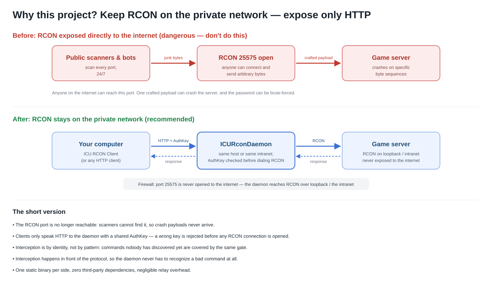
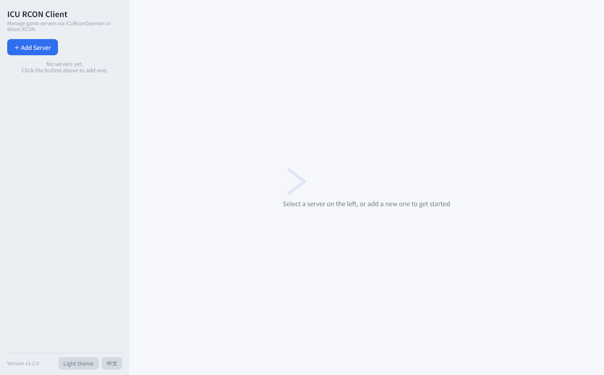
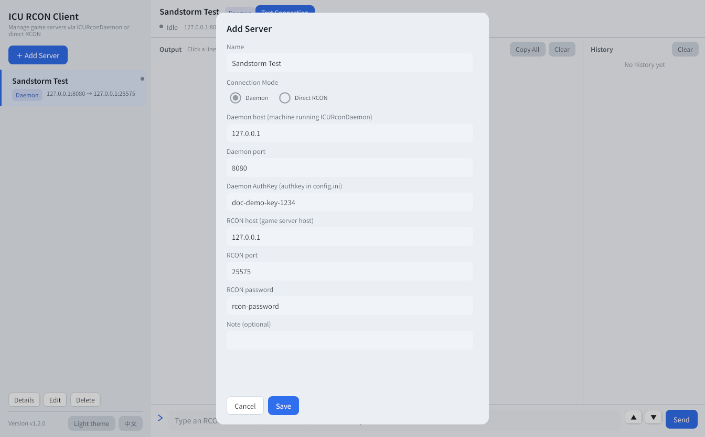
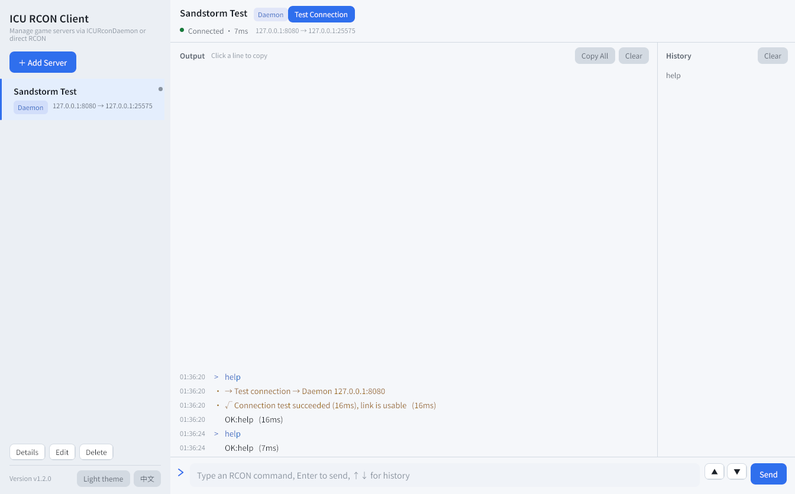

# ICU RCON — Illustrated Tutorial

**English** | [中文](使用教程.md)

> ICU RCON is a security-forwarding setup for Source RCON servers. It was built for
> *Insurgency: Sandstorm* servers and works the same way for Minecraft and any other
> Source RCON implementation. It ships as two single-file programs with no runtime
> dependencies. This guide assumes basic command-line and networking familiarity.

---

## What this project solves

A Source RCON port has two problems once it is reachable from the internet:

1. **Some RCON implementations crash when they receive specific byte sequences**, and
   internet-wide scanners hit RCON ports 24/7. If the port is open, anyone can take the
   server down whenever they like.
2. **RCON has no brute-force protection.** A password that sits on the public internet
   is a password that will eventually be guessed.

The project answers both with one structural change: it pulls the RCON port back onto the
private network and puts a small daemon in front of it. The daemon turns RCON into an HTTP
endpoint that requires an **AuthKey**, and clients talk only to the daemon. RCON itself is
never exposed.



| Role | File | Runs on | Purpose |
|---|---|---|---|
| Daemon | `ICURconDaemon-windows-amd64.exe` / `ICURconDaemon-linux-amd64` | The game server machine, or the same intranet | HTTP → RCON forwarding with AuthKey checks |
| Desktop client | `ICURconClient-windows-amd64.exe` / `ICURconClient-linux-amd64` | Your own computer | GUI for managing servers and running commands. Windows/Linux builds are published; macOS builds from source |
| Game server | — | Your server host | RCON enabled, port and password configured |

### Why the interception works

This is worth understanding before you deploy, because it is the whole security argument:

**The daemon does not recognize bad commands. It never sees an untrusted command at all.**

- Two routes exist — `POST /api/icu/daemon/rcon` for one command and
  `POST /api/icu/daemon/rcon/batch` for up to 8. Every other path is a plain 404.
- Every request must carry the AuthKey, and that check happens **before** the daemon opens
  any socket to RCON. A wrong key is dropped, so the game server's RCON handler never
  receives those bytes.
- An empty or missing AuthKey in `config.ini` is treated as "not configured": the daemon
  re-runs the first-run wizard instead of serving with a key that would accept everything.
- After authentication the daemon applies protocol hygiene: POST only, a 64 KB request-body
  cap, a 1446-byte command cap, bounded packet reads, multi-packet reassembly and full
  server timeouts.

Concretely, here is what happens to things people send at the port:

| What arrives | What the daemon does |
|---|---|
| Anything other than `POST` on either endpoint | `405 Only POST is supported` |
| A body that is not valid JSON, or larger than 64 KB | `400` — rejected before any RCON field is even looked at |
| Any other path (`/`, `/rcon`, scanner noise) | `404` |
| Valid JSON, wrong `auth` | `{"status":0,"msg":"Invalid authentication key"}`, and **no RCON connection is opened** |
| Valid JSON, correct `auth`, but the RCON password is wrong | `{"status":0,"msg":"Failed to connect to RCON server: ..."}` |
| Valid JSON, correct `auth`, valid RCON password | The command is forwarded, its reply returned, and the command logged with its round-trip time |

So "it blocks that one crash command" undersells it. It blocks the *path*, not the
*pattern*: payloads nobody has discovered yet are behind the same door, because there is
nobody on the other side of the door to send them.

---

## Deploying the daemon

### Windows

1. Download `ICURconDaemon-windows-amd64.exe` from Releases and put it in its own folder —
   it creates `config.ini` next to itself.
2. Run it. The first launch walks you through configuration:

   ```text
   === ICURconDaemon First Run Configuration ===
   Press Enter to use default value.
   Port [8080]:
   AuthKey [random UUID]:
   Config saved to config.ini
   Your AuthKey: 3f7a2c64-8d21-4e5b-9c77-a1b2c3d4e5f6
   Please keep your AuthKey safe!
   ICURconDaemon v1.2.0 starting on :8080
   ```

   Pressing Enter twice is the recommended path: port `8080`, and a strong random UUID v4
   as the AuthKey. When you see `starting on :8080`, it is up.
3. Leave the terminal window open — that window *is* the process. For production use,
   register it as a scheduled task or a Windows service so it survives logout and reboot.

### Linux

1. Upload the binary and make it executable:

   ```bash
   mkdir -p /opt/icurcond && cd /opt/icurcond
   # after uploading:
   chmod +x ICURconDaemon-linux-amd64
   ```

2. Run it once to generate the config. The prompts are identical to Windows:

   ```bash
   ./ICURconDaemon-linux-amd64
   # accept port and AuthKey with Enter, then ./config.ini is written and it starts listening
   ```

3. Let systemd look after it (recommended):

   ```ini
   # /etc/systemd/system/icurcond.service
   [Unit]
   Description=ICU RCON Daemon
   After=network.target

   [Service]
   WorkingDirectory=/opt/icurcond
   ExecStart=/opt/icurcond/ICURconDaemon-linux-amd64
   Restart=on-failure

   [Install]
   WantedBy=multi-user.target
   ```

   ```bash
   systemctl daemon-reload
   systemctl enable --now icurcond
   journalctl -u icurcond -f        # watch the forwarding log
   ```

### Verifying the forwarding path

From the machine running the daemon, hit the endpoint directly with `curl` — the fields are
exactly what the client sends:

```bash
curl -s -X POST http://127.0.0.1:8080/api/icu/daemon/rcon \
  -H 'Content-Type: application/json' \
  -d '{"ip":"127.0.0.1","port":25575,"passwd":"your-rcon-password","msg":"help","auth":"your-authkey"}'
```

A reply of `{"status":1,"msg":"..."}` means the whole chain works: HTTP → AuthKey → RCON.
If `status` is `0`, the `msg` field tells you which hop failed. Every successful forward
leaves a line in the daemon log:

```text
2026/10/15 01:36:20 127.0.0.1:25575 <- "help" (16ms, 123 bytes)
```

To check the batch path (one connection, several read-only commands):

```bash
curl -s -X POST http://127.0.0.1:8080/api/icu/daemon/rcon/batch \
  -H 'Content-Type: application/json' \
  -d '{"ip":"127.0.0.1","port":25575,"passwd":"your-rcon-password","auth":"your-authkey","msgs":["listplayers","gamemodeproperty NumPlayers"]}'
```

The response contains a `results` array in the same order as `msgs`. A command that fails
gets `status: 0` in its own entry; the rest still run.

Both endpoints compress their JSON when the request advertises `Accept-Encoding`
(`zstd`, `br` or `gzip`). `curl --compressed` negotiates and decodes automatically; without
the header the daemon answers with plain JSON, so old clients keep working.

A request with the wrong key is logged and rejected:

```text
2026/10/15 01:36:52 denied request from 203.0.113.7:41288: Invalid authentication key
```

### config.ini and day-to-day operations

`config.ini` sits next to the executable and holds exactly two settings:

```ini
port=8080
authkey=3f7a2c64-8d21-4e5b-9c77-a1b2c3d4e5f6
```

- Changes require a restart of the daemon.
- If the port is already in use, pick another one (e.g. `8081`) and update the client.
- Lost the AuthKey? Delete the `authkey=` line and run the daemon again to generate a new one.
- The file is written with `0600` permissions because it contains the only gate to your RCON.

---

## Using the desktop client

The desktop client uses the same secure channel as everything else, and is the comfortable
way to manage servers day to day. Download the build for your platform — a single file, no
installation:

- **Windows**: `ICURconClient-windows-amd64.exe`, just run it.
- **Linux**: `ICURconClient-linux-amd64`, `chmod +x` first; requires a desktop GL environment
  (the CI build targets glibc ≥ 2.35, i.e. Ubuntu 22.04+, Debian 12+).
- **macOS**: no prebuilt binary; build it from source as described in the README.

> The screenshots below show the English UI. The UI is bilingual — it follows
> the system locale and can be switched at the bottom-left corner.

### Adding a server

The first launch shows an empty list:



Click **＋ Add Server** and fill in:



| Field | Meaning |
|---|---|
| Name | Anything you like; used for display |
| Mode | **Daemon** — go through the daemon (recommended); **Direct RCON** — the client connects to the game server itself, which requires that port to be publicly reachable |
| Daemon host / port / AuthKey | The three values from the daemon's `config.ini` |
| RCON host / port / password | The game server's RCON settings, **as seen from the daemon's machine** |

The last row is the most common mistake: the RCON address is resolved by the daemon, not by
your computer. Same machine → `127.0.0.1`; separate machine → the game server's internal
address. Filling in a public IP here usually just walks into a firewall problem.

### Testing the connection

Double-click the card (or use **Test Connection**). The client sends `help`, which is
side-effect free and supported by virtually every RCON implementation. On success the top
bar turns green with the round-trip time:



### Running commands

Type into the bottom input (for example `list`, `say hello`, `whitelist add Steve`) and press
**Enter**:

- While a command is in flight, the same server will not accept a second one — this keeps
  RCON replies from interleaving.
- Output is shown live with timestamps and round-trip milliseconds, color-coded into
  command / response / error / system lines. Click any line to copy it; **Copy All** and
  **Clear** are next to the output. Large replies (for example a 100 KB+
  `listgamemodeproperties`) are split into display rows, so scrolling stays smooth and each
  individual line can be copied.
- Every command is appended to that server's history (last 200). Use the ▲▼ buttons or the
  arrow keys to recall one, or click an entry in the history column.
- If a command hangs, the **Send** button turns into a red **Stop** button that aborts the
  request.

### Managing servers, language and theme

- Single-click selects a card, double-click selects and tests it. **Details / Edit / Delete**
  sit below the list; deletion asks for confirmation.
- All changes are saved to `servers.json` immediately.
- The bottom-left corner toggles the UI language and the light/dark theme. The theme follows
  the system by default, and the theme choice is remembered.

---

## Troubleshooting

| Symptom | Cause and fix |
|---|---|
| `connection refused` (daemon mode) | Daemon not running, or wrong host/port. Check the process is alive and compare the client against `port=` in `config.ini` |
| `Invalid authentication key` / `denied request` | The client's AuthKey differs from `authkey=` in `config.ini`. Re-copy it, mind stray spaces, and restart the daemon after editing the config |
| `Failed to connect to RCON server: ...` | Auth passed but the daemon cannot reach the game server. Check that RCON is enabled, and that the RCON address is filled in from the daemon's point of view (`127.0.0.1` for same-machine setups) |
| `RCON authentication failed` (direct mode) | Wrong RCON password |
| `dial tcp ... i/o timeout` | Network or firewall in the way, or the target is not running |
| `unexpected response format` | The target is not a standard Source RCON server, or the port is something else entirely |
| Port already in use | Pick another port in `config.ini`, restart, and update the client |
| Daemon-mode command never returns | The RCON command is taking a long time (world saves, backups). The daemon waits up to 2 minutes, the client up to 140 seconds |
| Client does not start on Windows | Windows SmartScreen. Choose **More info → Run anyway** |

---

## Security checklist

- [ ] The game server's RCON port (25575 and friends) is **not** open to the internet at the
      router/firewall level.
- [ ] The daemon and the game server are on the same host or the same private network, and the
      client's RCON address is `127.0.0.1` or an internal address.
- [ ] The AuthKey is the generated random UUID and has never appeared in a public document,
      repository or screenshot.
- [ ] If the daemon's port is reachable from the internet, remember the AuthKey is the **only**
      gate — keep it strong and watch the log for `denied request` lines.

A few honest boundaries, so nobody is surprised later:

- **This is not content filtering.** Anyone holding a valid AuthKey can still send the crash
  command, and the daemon will forward it. What the design does is shrink "anyone on the
  internet" down to "whoever holds the key".
- **The API is plain HTTP.** The AuthKey travels in the request body. If the daemon crosses
  the public internet, put a TLS-terminating reverse proxy or a VPN in front of it.
- **There is no rate limiting or lockout.** A UUID v4 key makes guessing impractical, but
  brute-force protection is not a feature of the daemon — add it at the proxy/WAF in front
  if you need it.
- **The target address comes from the request body**, which is what lets one daemon serve many
  servers. A key holder can therefore make the daemon dial any reachable `host:port` that
  speaks the RCON handshake. If that matters to you, restrict the daemon's egress with a
  firewall or add an allow-list.

---

## Where to go next

- [README](../README.md) — feature list, HTTP API reference, `servers.json` format, build instructions.
- [Chinese tutorial](使用教程.md) — the same walkthrough in Chinese.
