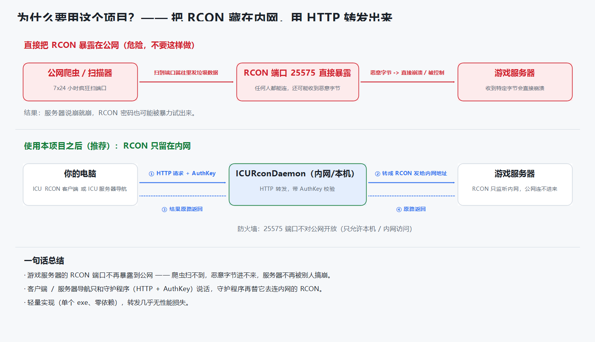
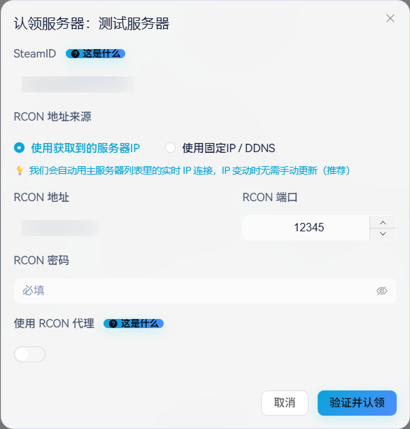
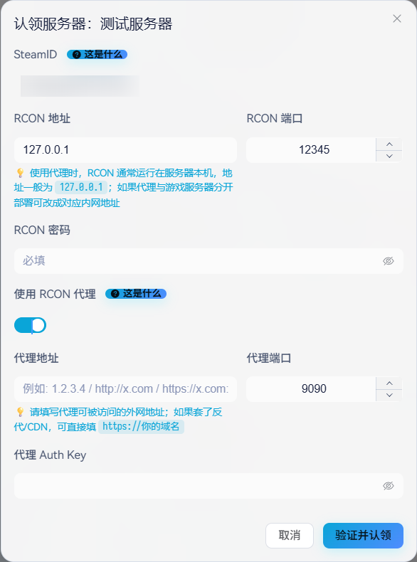
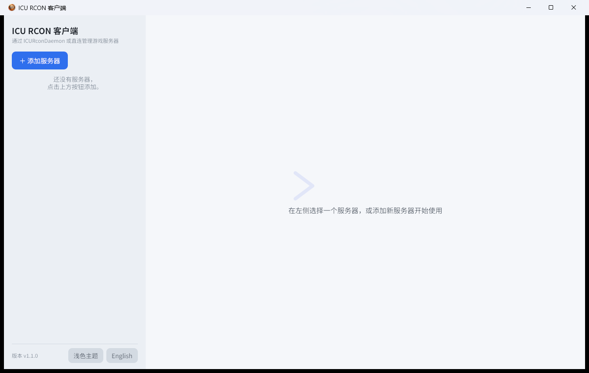
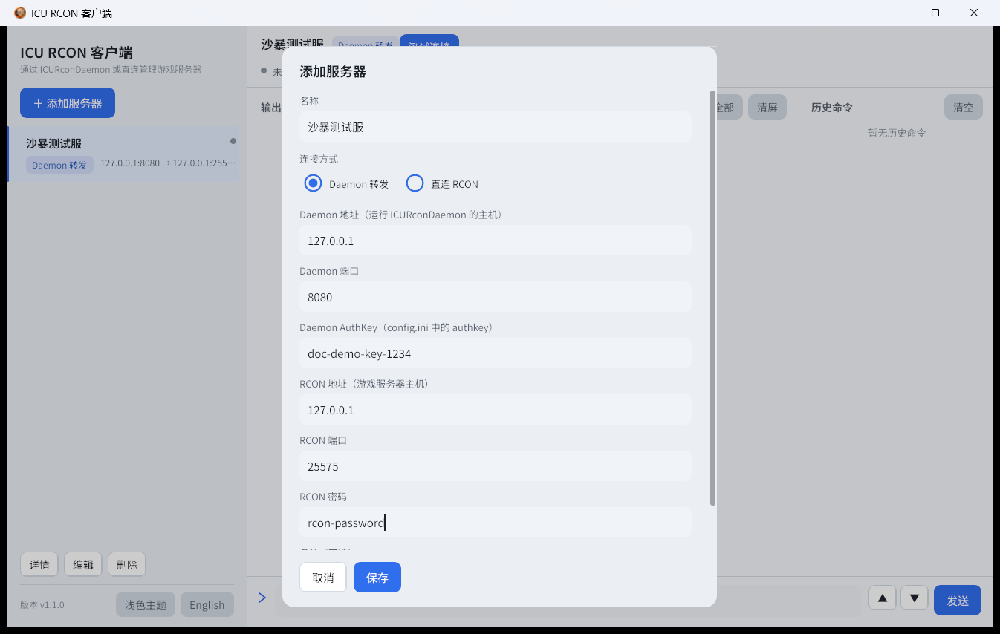
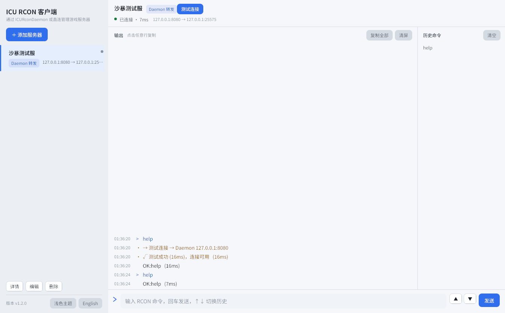

# ICU RCON 使用教程

[English](tutorial-en.md) | **中文**

> ICU RCON 是一套为《叛乱：沙漠风暴》（Insurgency: Sandstorm）游戏服务器打造的 RCON 安全转发方案，
> 同样适用于其他使用 Source RCON 协议的服务器（Minecraft 等）。整套方案由两个单文件程序组成，
> 无任何运行时依赖。本文假设你具备基本的命令行与网络常识。

## 这个项目解决什么问题

沙暴服务器自带的 RCON 有两个痛点：

1. **RCON 收到特定字节序列会直接崩溃**，而全网爬虫 7×24 小时在扫端口——服务器暴露在公网就意味着随时可能被陌生人搞崩；
2. RCON 协议本身没有防爆破机制，密码长期暴露在公网也存在被试出来的风险。

本项目把 RCON 端口收回内网，在其前面放一个轻量守护进程，把 RCON 转发成带 AuthKey 校验的 HTTP 接口。
工具侧（ICU RCON 客户端、ICU 服务器导航）只和守护进程通信，RCON 本身不再对公网开放。



| 角色 | 文件 | 运行位置 | 说明 |
|---|---|---|---|
| 守护进程 | `ICURconDaemon-windows-amd64.exe` / `ICURconDaemon-linux-amd64` | 游戏服务器所在机器（或同内网） | HTTP → RCON 转发，带 AuthKey 校验 |
| 桌面客户端 | `ICURconClient-windows-amd64.exe` / `ICURconClient-linux-amd64` | 你自己的电脑 | 图形界面管理服务器、执行 RCON 命令。Windows / Linux 提供 Release 版，macOS 需自行构建 |
| 游戏服务器 | —— | 机房 | 需要开启 RCON 并记下端口与密码 |

---

## 部署守护进程

### Windows 服务器

1. 从 [Releases](../README.md#安装与启动) 下载 `ICURconDaemon-windows-amd64.exe`，放进一个单独的目录（它会在同目录生成 `config.ini`）。
2. 双击运行，首次启动会进入交互配置：

   ```text
   === ICURconDaemon 首次运行配置 ===
   按回车键使用默认值。
   端口 [8080]:
   AuthKey [随机UUID]:
   配置已保存到 config.ini
   你的 AuthKey: 3f7a2c64-8d21-4e5b-9c77-a1b2c3d4e5f6
   请妥善保管你的 AuthKey！
   ICURconDaemon v1.1.0 启动于 :8080
   ```

   两个提示都直接回车即可：端口默认 8080，AuthKey 自动生成强随机 UUID。看到 `启动于 :8080` 即在工作。
3. 保持终端窗口开着（它就是进程本身），最小化即可。更正式的做法是注册为计划任务或 Windows 服务。

### Linux 服务器

1. 下载 `ICURconDaemon-linux-amd64`，上传到服务器并赋权：

   ```bash
   mkdir -p /opt/icurcond && cd /opt/icurcond
   # 上传后：
   chmod +x ICURconDaemon-linux-amd64
   ```

2. 首次运行，交互配置与 Windows 完全一致：

   ```bash
   ./ICURconDaemon-linux-amd64
   # 回车确认端口与 AuthKey 后，生成 ./config.ini 并开始监听
   ```

3. 用 systemd 托管（推荐）：

   ```ini
   # /etc/systemd/system/icurcond.service
   [Unit]
   Description=ICU RCON Daemon
   After=network.target

   [Service]
   WorkingDirectory=/opt/icurcond
   ExecStart=/opt/icurcond/ICURconDaemon-linux-amd64
   Restart=on-failure

   [Install]
   WantedBy=multi-user.target
   ```

   ```bash
   systemctl daemon-reload
   systemctl enable --now icurcond
   journalctl -u icurcond -f        # 查看转发日志
   ```

### 验证转发链路

守护进程所在机器上用 curl 直接打一次接口（字段与工具侧完全一致）：

```bash
curl -s -X POST http://127.0.0.1:8080/api/icu/daemon/rcon \
  -H 'Content-Type: application/json' \
  -d '{"ip":"127.0.0.1","port":25575,"passwd":"RCON密码","msg":"help","auth":"你的AuthKey"}'
```

返回 `{"status":1,"msg":"..."}` 即整条链路（HTTP → AuthKey 校验 → RCON）畅通；
`status:0` 时 `msg` 会说明原因。每次成功转发都会在守护进程日志里留一条记录：

```text
2026/10/15 01:36:20 127.0.0.1:25575 <- "help" (16ms)
```

收到错误 AuthKey 的请求则记录 `denied request from <ip>: AuthKey 无效` 并拒绝。

### 配置与日常运维

`config.ini` 与 exe 同目录，就两行：

```ini
port=8080
authkey=3f7a2c64-8d21-4e5b-9c77-a1b2c3d4e5f6
```

- 修改后需重启守护进程生效；
- 端口冲突时换一个端口（如 8081），工具侧同步修改；
- AuthKey 丢失就删掉 `authkey=` 这行重新运行，会重新生成。

---

## 接入 ICU 服务器导航（认领服务器）

导航的「认领服务器」对话框提供两种模式。**已部署守护进程的直接看代理模式。**

### 直连模式



| 字段 | 填写 |
|---|---|
| RCON 地址来源 | 选「使用获取到的服务器IP」——跟随服务器列表的实时 IP，IP 变动无需维护；有固定 IP / DDNS 才选另一项 |
| RCON 地址 | 游戏服务器 IP |
| RCON 端口 | RCON 监听端口（如 25575） |
| RCON 密码 | 游戏服务器的 RCON 密码 |
| 使用 RCON 代理 | 关闭 |

注意：ICU 服务器导航是远程服务，无法访问你的内网——直连模式意味着 RCON 端口必须对公网开放，这正是本文开头提到的风险状态。打算长期使用请切换到下面的代理模式。

### 代理模式（通过本守护进程，推荐）



打开「使用 RCON 代理」后多出三行代理字段：

| 字段 | 填写 | 来源 |
|---|---|---|
| RCON 地址 | 游戏服务器的 RCON 监听地址 | **以守护进程的视角看**：同机部署填 `127.0.0.1`，分机部署填内网地址 |
| RCON 端口 | 如 `25575` | 游戏服务器 RCON 配置 |
| RCON 密码 | 游戏服务器的 RCON 密码 | 游戏服务器 RCON 配置 |
| 代理地址 | 守护进程地址 | 服务器公网 IP，如 `1.2.3.4`；套了反向代理/CDN 时直接填域名 |
| 代理端口 | 守护进程端口 | `config.ini` 的 `port=`，默认 8080 |
| 代理 Auth Key | 守护进程的 AuthKey | `config.ini` 的 `authkey=` |

三个高频错误：

1. **代理 Auth Key ≠ RCON 密码**——前者校验守护进程，后者校验游戏服务器，两处各填各的；
2. **RCON 地址是守护进程看到的地址**，同机就填 `127.0.0.1`，填成公网 IP 通常会绕回防火墙问题；
3. 改过守护进程端口的话，代理端口要跟着改。

填完点「验证并认领」，导航会经守护进程发一条验证命令，通过即完成。

---

## 使用桌面客户端

桌面客户端与导航走同一条安全通道，适合日常管理：保存服务器列表、双击测试连接、执行命令并保留历史。
按平台下载（单文件，无需安装）：

- **Windows**：`ICURconClient-windows-amd64.exe`，直接运行；
- **Linux**：`ICURconClient-linux-amd64`，`chmod +x` 后运行，需要桌面图形环境（CI 基于 Ubuntu 22.04 构建，
  要求 glibc ≥ 2.35，即 Ubuntu 22.04+ / Debian 12+ 等主流发行版）；
- **macOS**：暂无预编译版本，可按 [README 的开发与测试](../README.md#开发与测试)章节自行构建。

首次启动左侧为空：



点「＋ 添加服务器」，按部署时的信息填写：



| 表单项 | 说明 |
|---|---|
| 名称 | 自定义，用于列表展示 |
| 连接方式 | Daemon 转发（默认，走守护进程，推荐）；直连则由客户端直连游戏服务器 RCON，远程服务器需对公网开放该端口 |
| Daemon 地址 / 端口 / AuthKey | 守护进程的 `config.ini` 三要素 |
| RCON 地址 / 端口 / 密码 | 游戏服务器的 RCON 信息（地址同样以守护进程视角填写） |

保存后双击卡片即可测试连接（发送 `help` 命令验证链路，无副作用），成功时顶栏变绿：



日常使用要点：

- 输入框回车发送；`↑`/`↓` 或 ▲▼ 按钮翻阅历史（每服务器独立保存 200 条，点击条目回填）；
- 输出区按颜色区分命令 / 响应 / 错误 / 系统提示，点击任意行复制该行，「复制全部」「清屏」在工具栏；
- 命令长时间无响应时「发送」变为红色「停止」，点击强制中断请求；
- 界面语言、明暗主题（默认跟随系统）都在左下角切换，选择会保存到 `servers.json`；
- 所有服务器信息存在 exe 同目录的 `servers.json`，换电脑拷走这个文件即可迁移。

---

## 常见问题排查

| 现象 | 原因 | 处理 |
|---|---|---|
| connection refused / 连接被拒绝 | 守护进程未运行，或 IP/端口不对 | 确认进程存活；核对 `config.ini` 的 `port` 与工具侧填写 |
| AuthKey 无效 / denied request | 工具侧 AuthKey 与 `config.ini` 不一致 | 重新复制粘贴，注意首尾空格；改过配置需重启守护进程 |
| RCON 连接失败（认证通过后） | 守护进程连不上游戏服务器 | 检查游戏服务器 RCON 是否开启；同机部署 RCON 地址填 `127.0.0.1` |
| RCON 认证失败 | RCON 密码错误 | 核对游戏服务器 RCON 密码 |
| 端口被占用 | 8080 被其他程序使用 | `config.ini` 换端口并重启，工具侧同步 |
| 客户端双击无反应 | Windows SmartScreen 拦截 | 「更多信息」→「仍要运行」 |

## 安全清单

- [ ] 游戏 RCON 端口（25575 等）在路由器/防火墙层面不对公网开放
- [ ] 守护进程与游戏服务器同机或同内网，RCON 地址填 `127.0.0.1` / 内网地址
- [ ] AuthKey 使用随机生成的 UUID，不写入任何公开文档
- [ ] 守护进程端口若需对公网开放，AuthKey 是唯一门禁——保持强随机，并留意日志中的 `denied request`
